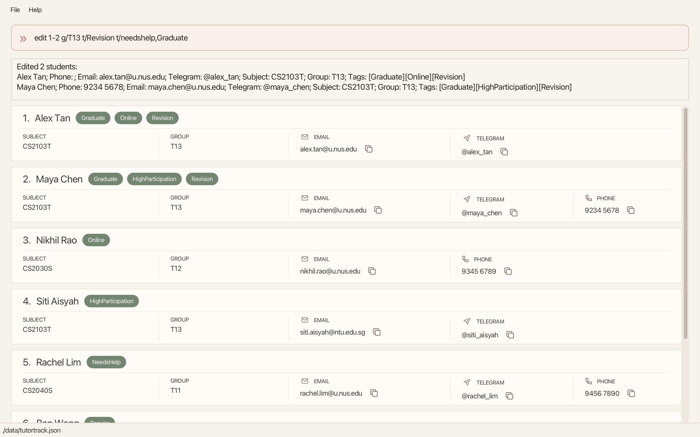
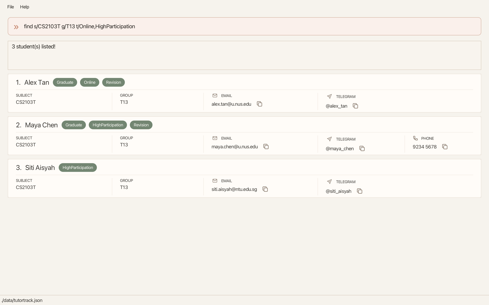

# TutorTrack User Guide

TutorTrack is a **desktop application for tutors to manage student records, optimized for use through a Command Line Interface (CLI)** while retaining the benefits of a Graphical User Interface (GUI). If you type quickly, TutorTrack can help you manage student records faster than traditional GUI applications.

<!-- * Table of Contents -->
<page-nav-print />

--------------------------------------------------------------------------------------------------------------------

## Quick start

1. Ensure that Java `25` or later is installed on your computer. 
   **Mac users:** Ensure you have the precise JDK version prescribed [here](https://se-education.org/guides/tutorials/javaInstallationMac.html).

1. Download the latest `.jar` file from [here](https://github.com/AY2627S1-CS2103T-T11-2/tp/releases).

1. Copy the file to the folder you want to use as the _home folder_ for TutorTrack.

1. Open a terminal, `cd` to the folder containing the JAR file, and run `java -jar tutortrack.jar`. 
   A GUI similar to the one below should appear in a few seconds. On first launch, TutorTrack contains some sample students; the screenshot shows other example student records. 
   

1. Type a command in the command box and press Enter to execute it. For example, type **`help`** and press Enter to open the help window. 
   Some example commands you can try:

   - `list` : Lists all students.

   - `add n/John Doe p/98765432 e/johnd@example.com h/@john_doe s/Mathematics g/Sec 3A` : Adds a student named `John Doe` to TutorTrack.

   - `delete 2,4-6` : Deletes the 2nd, 4th, 5th and 6th students shown in the current list.

   - `clear` followed by `clear confirm` : Deletes all student records.

   - `exit` : Exits the app.

1. Use the **Up Arrow (↑)** and **Down Arrow (↓)** keys in the command box to navigate previously submitted commands.

1. Refer to the [Features](#features) section below for details of each command.

---

## Features

<box type="info" seamless>

**Notes about the command format:** 

- Words in `UPPER_CASE` are the parameters to be supplied by the user. 
  For example, in `add n/NAME`, replace `NAME` with a value such as `John Doe`.

- Items in square brackets are optional. 
  For example, `n/NAME [t/TAG]` can be used as `n/John Doe t/friend` or as `n/John Doe`.

- Items followed by `...` can appear zero or more times. 
  For example, `[t/TAG]... ` may be omitted, or written as `t/friend` or `t/friend t/family`.

- Parameters can be in any order. 
  For example, if the command specifies `n/NAME p/PHONE_NUMBER`, `p/PHONE_NUMBER n/NAME` is also acceptable.

- The old `a/` address prefix is no longer supported and is rejected by `add` and `edit`. Use
  `h/TELEGRAM_HANDLE` for Telegram handles.

- Extraneous parameters for commands that take no parameters, such as `help`, `list`, and `exit`, are ignored. 
  For example, `help 123` is interpreted as `help`.

- If you are using a PDF version of this document, be careful when copying and pasting commands that span multiple lines as space characters surrounding line-breaks may be omitted when copied over to the application.
</box>

### Viewing help: `help`

- Opens a help window with a summary of the available commands and a link to the full User Guide.
- Close it using the window's native close control, <kbd>Command</kbd>+<kbd>W</kbd> on macOS, or <kbd>Alt</kbd>+<kbd>F4</kbd> where
supported by your operating system.
- You can also open the Help window by selecting **Help** > **Help** in the menu bar or by pressing <kbd>F1</kbd>.
- Press <kbd>Enter</kbd> while the Help window is open to copy the User Guide URL to the clipboard.

Format: `help`

### Navigating command history

When the command box is focused, you can reuse previously submitted commands:

- Press the **Up Arrow (↑)** key to move to an older command.
- Press the **Down Arrow (↓)** key to move towards newer commands.
- Moving down past the newest command restores the text you were previously typing.
- If you edit a recalled command, the edited text is preserved as your current draft until you submit it by pressing Enter.

Commands are added to the history when submitted, including commands that fail.

### Copying student details

Use the copy icon beside a displayed email address, Telegram handle, or phone number to copy that detail to the
clipboard.

### Adding a student: `add`

Adds a student to TutorTrack.

Format: `add n/NAME e/EMAIL s/SUBJECT g/GROUP [h/TELEGRAM_HANDLE] [p/PHONE] [t/TAG]...`

* `n/NAME`, `e/EMAIL`, `s/SUBJECT`, and `g/GROUP` are required.
* `p/PHONE`, `h/TELEGRAM_HANDLE`, and `t/TAG` are optional.
* If  `p/PHONE` or `h/TELEGRAM_HANDLE` is omitted or supplied without a value, the student has no phone number or Telegram handle.
* A student can have zero or more tags. To add multiple tags, repeat the `t/TAG` parameter.
* Parameters can be supplied in any order.

The following validation rules apply:

| Field | Prefix | Rules                                                                                                                                                                                                                                                                                                                                            |
| --- |--------|--------------------------------------------------------------------------------------------------------------------------------------------------------------------------------------------------------------------------------------------------------------------------------------------------------------------------------------------------|
| Name | `n/`   | Maximum 100 characters. Alphanumeric words may contain hyphens or apostrophes and are separated by single spaces. Initials and short abbreviations of up to three letters may end in a period when followed by another name, for example `S. Jay` or `Aisyah Bte. Ahmad`. One uppercase `D/O` or `S/O` may appear between name parts, for example `Ravi S/O Kumar`; lowercase `d/o` and `s/o` are not accepted because `s/` is the subject prefix. Repeated spaces are normalized to one space. |
| Phone | `p/`   | Optional. If provided, it must contain exactly 8 digits. A single space or hyphen is allowed between digit groups. Consecutive separators, country codes, and `+` are rejected. Numbers are stored and displayed as `xxxx xxxx`, for example `9123 4567`.                                                                                        |
| Email | `e/`   | Maximum 254 characters. Must use the `local-part@domain` format. The local part must start and end with an alphanumeric character; `+`, `_`, `.`, and `-` are allowed only between alphanumeric characters. Domain labels may be separated by periods, may contain hyphens only between alphanumeric characters, and the final label must be at least 2 characters long. |
| Telegram handle | `h/`   | Optional. If provided, it must begin with `@`, followed by 5 to 32 letters, digits, or underscores. The first character after `@` cannot be an underscore.                                                                                                                                                                                       |
| Subject | `s/`   | Maximum 100 characters. Must be non-blank and contain only alphanumeric characters and spaces.                                                                                                                                                                                                                                                    |
| Group | `g/`   | Maximum 100 characters. Must be non-blank. Any characters are allowed except reserved parameter-like tokens described below.                                                                                                                                                                                                                      |
| Tag | `t/`   | Maximum 50 characters. Must be non-blank and contain only alphanumeric characters without spaces. Tags appear in the order entered, including after saving and reopening. Tags are unique ignoring case; repeated tags such as `Student` and `student` are stored once, using the first spelling supplied.                                      |

* Leading and trailing whitespace around each value is ignored. Whitespace-only phone and Telegram values are treated as empty.
* Unknown parameter-like tokens such as `x/typo` are rejected. A token beginning at the start of the input or after
  whitespace, with a letter followed by letters, digits, underscores, or hyphens and then `/`, is reserved for command
  prefixes. To include literal text such as `x/typo` in a group, put a space before the slash: `g/T11 x /typo`.
  Embedded slashes such as `g/T11/T12` and URLs such as `g/https://example.com` are accepted.
* TutorTrack trims names and collapses consecutive internal whitespace before storing them. Two students
are duplicates when their normalized names are the same, ignoring letter case. If `John Tan` already exists,
`john tan` and `JOHN TAN` are rejected even if the other details are different. The capitalization originally entered
for an accepted student is preserved for storage and display.
* Two distinct students with the same name cannot coexist in TutorTrack. This is a known limitation.

<box type="tip" seamless>

**Tip:** The Telegram handle is optional. If it is not known when adding a student, it can be added later using the
`edit` command.
</box>

Examples:
* `add n/Alice Tan p/91234567 e/alice@example.com h/@alice_tan s/Mathematics g/Sec 3A t/NeedsHelp`
* `add n/Bob Lee p/92345678 e/bob@example.com h/@bob_lee s/Physics g/J1A t/NeedsHelp t/Online`
* `add n/Jean-Luc O'Connor p/9123 4567 e/jean@example.com h/@jean_luc s/Physics g/J1A`
* `add n/A. R. Rahman e/rahman@example.com s/Mathematics g/T11`
* `add n/Ravi S/O Kumar e/ravi@example.com s/CS2103T g/T11`
* `add n/Charlie Lim e/charlie@example.com s/Mathematics g/Sec 3A` adds a student without a phone number, Telegram
  handle, or tags.

### Listing all students: `list`

Shows a list of all students in TutorTrack.

Format: `list`

### Editing students: `edit`

Edits one or more students in the currently displayed list.

Format: `edit INDEX_OR_RANGE[,INDEX_OR_RANGE]... [n/NAME] [p/PHONE] [e/EMAIL] [h/TELEGRAM_HANDLE] [s/SUBJECT] [g/GROUP] [t/TAG]... [t/OLD_TAG,NEW_TAG]...`

At least one optional field must be supplied. Omitted fields remain unchanged.
Fields are replaced by default. Tags are added using `t/TAG`, while an existing tag is renamed using `t/OLD_TAG,NEW_TAG`.
Empty values, including whitespace-only values, are rejected; use `delete` to clear optional fields.

#### Selecting students

- `INDEX_OR_RANGE` is either an individual `INDEX` or an inclusive range written as `START_INDEX-END_INDEX`.
- The indexes refer to the index numbers in the currently displayed student list. Each index must be a positive integer: 1, 2, 3, ...
- Commas can combine individual indexes and ranges, for example `1,3-5,7`.
- Spaces are not allowed inside the index expression. For example, use `1,3-5`, not `1, 3 - 5`.
- Duplicate and overlapping indexes select each student only once.
- All indexes are validated before any student is edited. If any index is invalid, nobody is edited.
- The current filter stays active after an edit, including a bulk edit. Edited students disappear from the displayed
  list if they no longer match the filter. Use `list` to show everyone again.

#### Fields available

| Selected students | Allowed fields |
| --- | --- |
| One student | `n/`, `p/`, `e/`, `h/`, `s/`, `g/`, `t/` |
| Multiple students | `s/`, `g/`, `t/` only |

- Only one subject and one group can be supplied in each command.
- Unknown prefixes and slashes in group values follow the same rules as [adding a student](#adding-a-student-add).

#### Editing tags and clearing fields

- Tags contain only letters and digits; internal spaces are not allowed. Whitespace around tag values and the
  comma in a rename is trimmed.
- `t/TAG` adds a tag while preserving existing tags. Matching ignores case: adding `t/online` when `Online`
  exists keeps the existing spelling `Online`.
- `t/OLD_TAG,NEW_TAG` renames a tag, matching `OLD_TAG` without case and displaying the exact capitalization of
  `NEW_TAG`. For example, `t/needshelp, ONLINE` replaces `NeedsHelp` with `ONLINE`.
- If the replacement tag already exists, the two tags merge into one using the replacement's capitalization.
  The renamed tag retains its position; any duplicate destination tag is removed.
- Additions and renames run left to right. `edit 1 t/New t/New,Updated` adds `Updated` to the first student index while retaining unrelated tags.
- If any rename source is missing, the entire command fails and nobody is changed, including for bulk edits.
- Empty `t/`, `p/`, and `h/` are rejected by `edit`. Use `delete 1 t/`, `delete 1 p/`, or `delete 1 h/` to clear them.
- Other field formats and whitespace normalization follow the rules in [Adding a student](#adding-a-student-add).
- A name cannot be changed to another student's name, ignoring letter case. Changing only the selected student's
  capitalization is allowed and the newly entered capitalization is stored and displayed; for example, changing
  `John Tan` to `JOHN TAN` succeeds.

Examples:

* `edit 1 p/91234567 e/johndoe@example.com h/@johndoe` Edits the phone number, email address and Telegram handle
    of the 1st student to be `9123 4567`, `johndoe@example.com` and `@johndoe` respectively.
* `edit 2 n/Betsy Crower t/friends,Graduate` Changes the name of the 2nd student to `Betsy Crower` and renames the tag `friends` to `Graduate`.
* `edit 1-3 s/CS3240 g/T11 t/Graduate t/online` Updates the subject to CS3240, group to T11, and add the tags `Graduate` and `online` to the first three displayed students to CS3240, T11.
* `find n/Alice` followed by `edit 1 g/T12` Updates the first matching student's group and keeps the name filter active.

The following example shows a bulk edit that updates a group, adds a tag, and renames an existing tag.

### Locating students: `find`

Finds students by `name`, `Telegram handle`, `subject`, `group`, `tag`, or a combination of these criteria.

Formats:

- `find [n/NAME_TERM[,NAME_TERM]...] [h/TELEGRAM_HANDLE] [s/SUBJECT] [g/GROUP] [t/TAG_EXPRESSION]`, where a
  name term is a `KEYWORD` or `"PHRASE"`

- At least one name, Telegram handle, subject, group, or tag criterion must be provided. Only one of each prefix can be supplied.
- All searches are case-insensitive; for example, `n/hans` matches `Hans`, `g/t11` matches `T11`, and
  `t/needshelp` matches `needsHelp`.
- Separate multiple name terms with commas. A student matching any name term is returned (an `OR` search).
- An unquoted keyword matches only a complete name component. Spaces, hyphens, apostrophes, and periods separate
  components; for example, `n/Jean` matches `Jean-Luc`, `n/df` matches `df. f`, while `n/Han` does not match `Hans`.
- A quoted phrase performs a substring match; for example, `n/"lex Ye"` matches `Alex Yeoh`.
- Each name keyword or phrase is limited to 100 characters and uses the same word, abbreviation, and relationship
  qualifier syntax as names. Invalid terms such as `n/!!!`, `n/@`, `n/-`, and `n/"abc/def"` are rejected.
- A Telegram handle must include its leading `@` and is matched exactly, ignoring letter case.
- Subject, group, and tag filters require an exact match, ignoring letter case.
- Within `TAG_EXPRESSION`, separate tags with `,` for an `OR` search; for example, `t/lowAttendance,needsHelp` matches a
  student with either the `lowAttendance` or `needsHelp` tag.
- Within `TAG_EXPRESSION`, separate tags with `&` for an `AND` search; for example, `t/lowAttendance&needsHelp` matches only a
  student with both the `lowAttendance` and `needsHelp` tags.
- `,` and `&` cannot be used together in the same tag expression.
- When a name, Telegram handle, subject, group, or tag criteria are combined, a student must match every supplied
  criterion type
  (an `AND` search).

Examples:
* `find n/alex,david` returns `Alex Yeoh`,`Alex Goh`, `Alex Tan` and `David Li`. 
* `find n/"Alex Yeoh",David` returns contacts containing either the names `Alex Yeoh` or  `David`.
* `find s/CS2103T g/T11` returns students in group `T11` whose subject is `CS2103T`.
* `find t/highParticipation,needsHelp` returns students tagged `highParticipation` or `needsHelp`.
* `find t/highParticipation&needsHelp` returns students tagged with both `highParticipation` and `needsHelp`.

The following example shows a combined subject, group, and tag search.

### Deleting students or optional fields: `delete`

Without field prefixes, deletes one or more students. With field prefixes, clears only the specified optional fields.

Format: `delete INDEX_OR_RANGE[,INDEX_OR_RANGE]... [p/] [h/] [t/TAG]...`

* `INDEX_OR_RANGE` is either an individual `INDEX` or an inclusive range written as `START_INDEX-END_INDEX`.

* The index refers to the index number shown in the displayed student list.
* The index **must be a positive integer** 1, 2, 3, ...
* Commas can be used to combine individual indexes and ranges.
* Spaces are not allowed around commas or hyphens. For example, use `delete 1,3-5` not `delete 1, 3 - 5`.
* Duplicate and overlapping indexes are deleted only once. For example, `delete 1-3,2-4` deletes students 1 through 4.
* All indexes are validated before any student is deleted. If any index is invalid, no students are deleted.

#### Deleting optional fields

- `p/` clears the phone number; `h/` clears the Telegram handle. These prefixes accept no value and may each appear
  once. Clearing an already empty phone or handle succeeds.
- `t/TAG` deletes a tag by name, ignoring case. Repeat `t/TAG` to delete multiple tags. Repeated names are treated
  as one deletion.
- An empty `t/` clears all tags, even when named tags in the same command do not exist:
  `delete 1 t/ t/Missing` clears all tags.
- Name (`n/`), email (`e/`), subject (`s/`), and group (`g/`) are compulsory and cannot be deleted.
- Field deletions support the same indexes and ranges as deleting students. All indexes and requested tags are
  validated before any changes are made. Unless clearing all tags, a missing requested tag for any selected student
  rejects the entire command. For example, `delete 1-3 t/Online` fails without making changes if only students
  1 and 2 have that tag.
- Deleting fields preserves the current filter. Deleting student records shows all remaining students.

Examples:
* `find n/Betsy` followed by `delete 1` deletes the 1st student in the results of the `find` command.
* `list` followed by `delete 1,3-5,6` deletes the 1st, 3rd, 4th, 5th and 6th students in TutorTrack.
* `delete 1 p/ h/ t/Online t/needsHelp` clears phone and Telegram handle and removes those two tags.
* `delete 1-3 t/` clears all tags for the first three displayed students.

### Clearing all entries: `clear`

Requests confirmation before clearing all student records from TutorTrack.

Format: `clear`, followed by `clear confirm`

`clear` does not delete any student records. It asks for confirmation; enter `clear confirm` next to delete all student records.
Any other parameter is rejected, and entering another command cancels the pending confirmation.

### Exiting the program: `exit`

Exits the program.

Format: `exit`

### Saving the data

TutorTrack automatically saves data after successfully executing a command. You do not need to save manually.

### Editing the data file

TutorTrack data is saved automatically as a JSON file `[JAR file location]/data/tutortrack.json`. Advanced users are welcome to update data directly by editing that data file.

If you used an earlier version that saved data as `[JAR file location]/addressbook.json` or `[JAR file location]/data/addressbook.json`,
TutorTrack automatically copies that file to `[JAR file location]/data/tutortrack.json` the first time it starts. The original `addressbook.json`
file is kept as a backup. If the copy cannot be made, TutorTrack continues using the original file so your data is still loaded.

<box type="warning" seamless>

**Caution:**

* **Back up first.** Editing the data file directly is for advanced users; create a backup before making changes.
* **Invalid data.** If the data file cannot be loaded, for example because a value is invalid or longer than its
  maximum length, TutorTrack shows an error naming the file and closes without changing it. Fix the file, or move it
  to another folder to start again with sample data.
* **Older data.** A non-empty physical address in the JSON `"address"` field does not cause a student record to be
  rejected. TutorTrack loads the record with an empty Telegram handle instead. Values beginning with `@` must also
  satisfy the current Telegram-handle format; otherwise, they are cleared. This conversion does not create a backup. The
  file remains unchanged until the next successful command saves the loaded data, replacing the old physical address
  with an empty value.
* **Other manual changes.** Values outside their accepted range can cause unexpected behaviour. Edit the file only
  when you are confident that the changes are valid.
</box>

---

## FAQ

**Q**: How do I transfer my data to another computer? 
**A**: Install TutorTrack on the other computer and overwrite the data file it creates with the data file from your previous TutorTrack home folder.

---

## Known issues

1. **When using multiple screens**, if you move the application to a secondary screen, and later switch to using only the primary screen, the GUI will open off-screen. The remedy is to delete the `preferences.json` file created by the application before running the application again.

---

## Command summary

| Action | Format / Example                                                                                                                                                          |
| ------ |---------------------------------------------------------------------------------------------------------------------------------------------------------------------------|
| **Add** | `add n/NAME [p/PHONE] e/EMAIL [h/TELEGRAM_HANDLE] s/SUBJECT g/GROUP [t/TAG]...` e.g., `add n/Ravi S/O Kumar e/ravi@example.com s/CS2103T g/T11`                  |
| **Clear** | `clear`, then `clear confirm`                                                                                                                                             |
| **Delete** | `delete INDEX_OR_RANGE[,INDEX_OR_RANGE]... [p/] [h/] [t/TAG]...`  e.g., `delete 1,3-5,7 t/`                                                                            |
| **Edit** | `edit INDEX_OR_RANGE[,INDEX_OR_RANGE]... [n/NAME] [p/PHONE] [e/EMAIL] [h/TELEGRAM_HANDLE] [s/SUBJECT] [g/GROUP] [t/TAG]... [t/OLD_TAG,NEW_TAG]...` e.g., `edit 1,3-5 s/CS3240 g/T11 t/online` |
| **Find** | `find [n/NAME_TERM[,NAME_TERM]...] [h/TELEGRAM_HANDLE] [s/SUBJECT] [g/GROUP] [t/TAG_EXPRESSION]` e.g., `find n/alex,david`                                     |
| **List** | `list`                                                                                                                                                                    |
| **Help** | `help`                                                                                                                                                                    |
| **Exit** | `exit`                                                                                                                                                                    |
