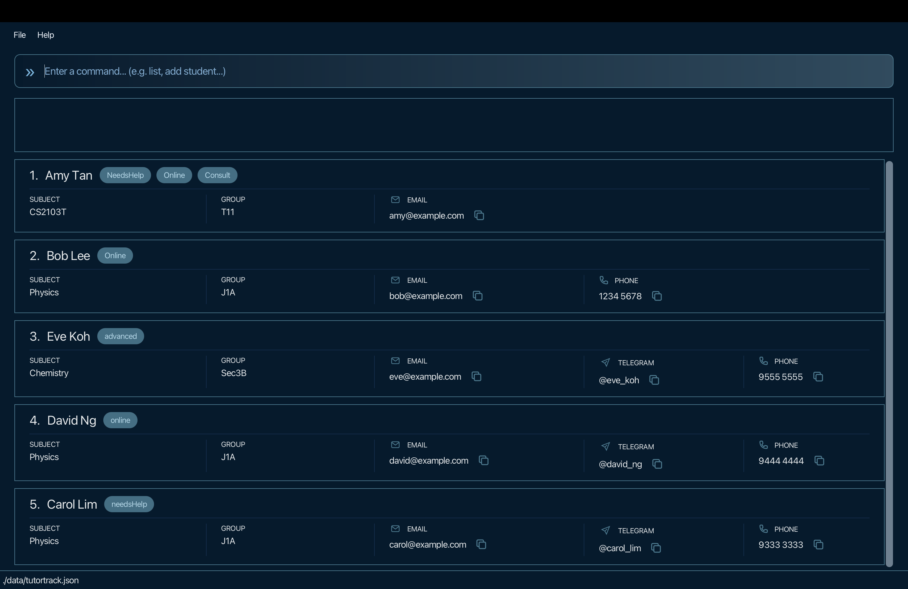

# TutorTrack User Guide

TutorTrack is a **desktop application for tutors to manage student contacts, optimized for use through a Command Line Interface (CLI)** while retaining the benefits of a Graphical User Interface (GUI). If you type quickly, TutorTrack can help you manage student contacts faster than traditional GUI applications.

<!-- * Table of Contents -->
<page-nav-print />

--------------------------------------------------------------------------------------------------------------------

## Quick start

1. Ensure that Java `25` or later is installed on your computer. 
   **Mac users:** Ensure you have the precise JDK version prescribed [here](https://se-education.org/guides/tutorials/javaInstallationMac.html).

1. Download the latest `.jar` file from [here](https://github.com/AY2627S1-CS2103T-T11-2/tp/releases).

1. Copy the file to the folder you want to use as the _home folder_ for your AddressBook.

1. Open a terminal, `cd` to the folder containing the JAR file, and run `java -jar addressbook.jar`. 
   A GUI similar to the one below should appear in a few seconds. Note how the app contains some sample data. 
   

1. Type a command in the command box and press Enter to execute it. For example, type **`help`** and press Enter to open the help window. 
   Some example commands you can try:

   - `list` : Lists all students.

   - `add n/John Doe p/98765432 e/johnd@example.com h/@john_doe s/Mathematics g/Sec 3A` : Adds a student named `John Doe` to TutorTrack.

   * `delete 2,4-6` : Deletes the 2nd, 4th, 5th and 6th contacts shown in the current list.

   - `clear` : Deletes all contacts.

   - `exit` : Exits the app.

1. Use the **Up Arrow (↑)** and **Down Arrow (↓)** keys in the command box to navigate previously submitted commands.

1. Refer to the [Features](#features) section below for details of each command.

---

## Features

<box type="info" seamless>

**Notes about the command format:** 

- Words in `UPPER_CASE` are the parameters to be supplied by the user. 
  For example, in `add n/NAME`, replace `NAME` with a value such as `John Doe`.

- Items in square brackets are optional. 
  For example, `n/NAME [t/TAG]` can be used as `n/John Doe t/friend` or as `n/John Doe`.

- Items followed by `...` can appear zero or more times. 
  For example, `[t/TAG]... ` may be omitted, or written as `t/friend` or `t/friend t/family`.

- Parameters can be in any order. 
  For example, if the command specifies `n/NAME p/PHONE_NUMBER`, `p/PHONE_NUMBER n/NAME` is also acceptable.

- The old `a/` address prefix is no longer supported and is rejected by `add` and `edit`. Use
  `h/TELEGRAM_HANDLE` for Telegram handles.

- Extraneous parameters for commands that take no parameters, such as `help`, `list`, `exit`, and `clear`, are ignored. 
  For example, `help 123` is interpreted as `help`.

- If you are using a PDF version of this document, be careful when copying and pasting commands that span multiple lines as space characters surrounding line-breaks may be omitted when copied over to the application.
</box>

### Viewing help: `help`

Opens a help window with a summary of the available commands and a link to the full User Guide.

Format: `help`

### Navigating command history

When the command box is focused, you can reuse previously submitted commands:

- Press the **Up Arrow (↑)** key to move to an older command.
- Press the **Down Arrow (↓)** key to move towards newer commands.
- Moving down past the newest command restores the text you were previously typing.
- If you edit a recalled command, the edited text is preserved as your current draft until you submit it by pressing Enter.

Commands are added to the history when submitted, including commands that fail.

### Adding a person: `add`

Adds a student to TutorTrack.

Format: `add n/NAME [p/PHONE] e/EMAIL [h/TELEGRAM_HANDLE] s/SUBJECT g/GROUP [t/TAG]...`

* `n/NAME`, `e/EMAIL`, `s/SUBJECT`, and `g/GROUP` are required.
* `p/PHONE`, `h/TELEGRAM_HANDLE`, and `t/TAG` are optional.
* If  `p/PHONE` or `h/TELEGRAM_HANDLE` is omitted or supplied without a value, the student has no phone number or Telegram handle.
* A student can have zero or more tags. To add multiple tags, repeat the `t/TAG` parameter.
* Parameters can be supplied in any order.

The following validation rules apply:

| Field | Prefix | Rules                                                                                                                                          |
| --- |--------|------------------------------------------------------------------------------------------------------------------------------------------------|
| Name | `n/`   | Must be non-blank. Alphanumeric words may contain hyphens or apostrophes and are separated by single spaces. Initials and short abbreviations of up to three letters may end in a period when followed by another name, for example `S. Jay` or `Aisyah Bte. Ahmad`. Repeated spaces are normalized to one space. |
| Phone | `p/`   | Optional. If provided, it must contain exactly 8 digits. A single space or hyphen is allowed between digit groups. Consecutive separators, country codes, and `+` are rejected. Numbers are stored and displayed as `xxxx xxxx`, for example `9123 4567`. |
| Email | `e/`   | Must use the `local-part@domain` format. The local part must start and end with an alphanumeric character; `+`, `_`, `.`, and `-` are allowed only between alphanumeric characters. Domain labels may be separated by periods, may contain hyphens only between alphanumeric characters, and the final label must be at least 2 characters long. |
| Telegram handle | `h/`   | Optional. If provided, it must begin with `@`, followed by 5 to 32 letters, digits, or underscores. The first character after `@` cannot be an underscore.                                                                                                                                                                                       |
| Subject | `s/`   | Must be non-blank and contain only alphanumeric characters and spaces.                                                                                                                                                                                                                                                                           |
| Group | `g/`   | Must be non-blank. Any characters are allowed except reserved parameter-like tokens described below.                                                                                                                                                                                                                                                                        |
| Tag | `t/`   | Must be non-blank and contain only alphanumeric characters. Tags appear in the order entered, including after saving and reopening. Tags are unique ignoring case; repeated tags such as `Student` and `student` are stored once, using the first spelling supplied. |

* Leading and trailing whitespace around each value is ignored. Whitespace-only phone and Telegram values are treated as empty.
* Unknown parameter-like tokens such as `x/typo` are rejected. A token beginning at the start of the input or after
  whitespace, with a letter followed by letters, digits, underscores, or hyphens and then `/`, is reserved for command
  prefixes. To include literal text such as `x/typo` in a group, put a space before the slash: `g/T11 x /typo`.
  Embedded slashes such as `g/T11/T12` and URLs such as `g/https://example.com` are accepted.
* TutorTrack trims names and collapses consecutive internal whitespace before storing them. Two students
are duplicates when their normalized names are exactly the same, including letter case. If an existing student has the
same name, the new student is rejected even if the other details are different.

<box type="tip" seamless>

**Tip:** The Telegram handle is optional. If it is not known when adding a student, it can be added later using the
`edit` command.
</box>

Examples:
* `add n/Alice Tan p/91234567 e/alice@example.com h/@alice_tan s/Mathematics g/Sec 3A t/Student`
* `add n/Bob Lee p/92345678 e/bob@example.com h/@bob_lee s/Physics g/J1A t/Student t/Online`
* `add n/Jean-Luc O'Connor p/9123 4567 e/jean@example.com h/@jean_luc s/Physics g/J1A`
* `add n/A. R. Rahman e/rahman@example.com s/Mathematics g/T11`
* `add n/Charlie Lim e/charlie@example.com s/Mathematics g/Sec 3A` adds a student without a phone number, Telegram
  handle, or tags.

### Listing all persons: `list`

Shows a list of all persons in the address book.

Format: `list`

### Editing persons: `edit`

Edits one or more persons in the currently displayed list.

Format: `edit INDEX_OR_RANGE[,INDEX_OR_RANGE]... [n/NAME] [p/PHONE] [e/EMAIL] [h/TELEGRAM_HANDLE] [s/SUBJECT] [g/GROUP] [t/TAG]...`

At least one field must be supplied. Omitted fields remain unchanged; supplied fields replace the corresponding
existing values.

#### Selecting persons

- `INDEX_OR_RANGE` is either an individual `INDEX` or an inclusive range written as `START_INDEX-END_INDEX`.
- The indexes refer to the index numbers in the currently displayed person list. Each index must be a positive integer: 1, 2, 3, ...
- Commas can combine individual indexes and ranges, for example `1,3-5,7`.
- Spaces are not allowed inside the index expression. For example, use `1,3-5`, not `1, 3 - 5`.
- Duplicate and overlapping indexes select each person only once.
- All indexes are validated before any person is edited. If any index is invalid, nobody is edited.
- The current filter stays active after an edit, including a bulk edit. Edited persons disappear from the displayed
  list if they no longer match the filter. Use `list` to show everyone again.

#### Fields available

| Selected persons | Allowed fields |
| --- | --- |
| One person | `n/`, `p/`, `e/`, `h/`, `s/`, `g/`, `t/` |
| Multiple persons | `s/`, `g/`, `t/` only |

- Only one subject and one group can be supplied in each command.
- Unknown parameter-like tokens such as `x/typo` are rejected, including inside group values. A token beginning at
  the start of the input or after whitespace, with a letter followed by letters, digits, underscores, or hyphens and
  then `/`, is reserved for command prefixes. Only `n/`, `p/`, `e/`, `h/`, `s/`, `g/`, and `t/` are supported.
  To include literal text such as `x/typo` in a group, put a space before the slash: `g/T11 x /typo`.
  Embedded slashes such as `g/T11/T12` and URLs such as `g/https://example.com` are accepted.

#### Clearing and replacing fields

| Field | Behaviour |
| --- | --- |
| Name, email, subject, group | Cannot be cleared. |
| Phone | Use `p/` with no value to clear it. |
| Telegram handle | Use `h/` with no value to clear it. |
| Tags | Each empty `t/` removes one tag from the end (the rightmost displayed tag). Repeat it to remove more tags: `t/ t/` removes the last two. Extra empty prefixes after all tags are removed have no further effect. Non-empty supplied tags replace all existing tags in the order entered. Do not mix empty and non-empty tag values. |

- Field formats, whitespace normalization, and validation follow the rules in
  [Adding a person](#adding-a-person-add). For `edit`, a whitespace-only phone
  or Telegram value clears that field.
- To remove only one tag, supply all tags you want to keep. For example, if a person has `Student` and `Online`,
  `edit 1 t/Student` removes `Online` and keeps `Student`. Alternatively, `edit 1 t/` removes the last tag,
  also leaving `Student`. To remove both, use `edit 1 t/ t/`.
- For bulk edits, the number of empty `t/` prefixes applies separately to each selected person's tags.
- Tag comparisons ignore case: `edit 1 t/Student t/student` stores one tag, displayed as `Student`.

Examples:

* `edit 1 p/91234567 e/johndoe@example.com h/@johndoe` Edits the phone number, email address and Telegram handle
    of the 1st person to be `9123 4567`, `johndoe@example.com` and `@johndoe` respectively.
* `edit 2 n/Betsy Crower t/` Edits the name of the 2nd person to be `Betsy Crower` and removes their last tag.
* `edit 1-3 s/CS3240 g/T11 t/student t/online` Updates the subject, group, and tags of the first three displayed persons.
* `edit 1 p/ h/ t/` Clears the first person's phone number and Telegram handle, and removes their last tag.
* `edit 1 t/Student t/Online` Replaces the person's tags with `Student` followed by `Online`.
* `edit 1 t/ t/` Removes the last two tags. If the person has `Student` and `Online`, both are removed.
* `edit 1 e/alice@x.a-b` Sets a valid email with a hyphenated final domain label of at least two characters.
* `edit 1 p/1--- --2 3` Is rejected because phone separators cannot be consecutive.
* `edit 1 p/912345678` Is rejected because phone numbers must have exactly eight digits.
* `edit 1 g/T11 x/typo` Is rejected because `x/` is not a supported prefix.
* `find n/Alice` followed by `edit 1 g/T12` Updates the first matching person's group and keeps the name filter active.
* `edit 1 n/` Is rejected because Name cannot be empty.
* `edit 1 h/alice` Is rejected because Telegram handle needs to start with '@'.

### Locating persons: `find`

Finds persons by name, Telegram handle, subject, group, tag, or a combination of these criteria.

Formats:

- `find [n/NAME_TERM[,NAME_TERM]...] [h/TELEGRAM_HANDLE] [s/SUBJECT] [g/GROUP] [t/TAG_EXPRESSION]`, where a
  name term is a `KEYWORD` or `"PHRASE"`

- At least one name, Telegram handle, subject, group, or tag criterion must be provided.
- All searches are case-insensitive; for example, `n/hans` matches `Hans`, `g/t11` matches `T11`, and
  `t/needshelp` matches `needsHelp`.
- Separate multiple name terms with commas. A person matching any name term is returned (an `OR` search).
- An unquoted keyword matches only a complete name component. Spaces, hyphens, and apostrophes separate components;
  for example, `n/Jean` matches `Jean-Luc`, while `n/Han` does not match `Hans`.
- A quoted phrase performs a substring match; for example, `n/"lex Ye"` matches `Alex Yeoh`.
- A Telegram handle must include its leading `@` and is matched exactly, ignoring letter case.
- Subject, group, and tag filters require an exact match, ignoring letter case.
- Only one of each prefix can be supplied.
- Within `TAG_EXPRESSION`, separate tags with `,` for `OR`; for example, `t/lowAttendance,needsHelp` matches a
  person with either tag.
- Within `TAG_EXPRESSION`, separate tags with `&` for `AND`; for example, `t/lowAttendance&needsHelp` matches only a
  person with both tags.
- `,` and `&` cannot be used together in the same tag expression.
- When name, Telegram handle, subject, group, or tag criteria are combined, a person must match every supplied
  criterion type
  (an `AND` search).

Examples:
* `find n/John` returns `john` and `John Doe`.
* `find n/alex,david` returns `Alex Yeoh` and `David Li`. 
* `find n/"Alex Yeoh"` returns names containing the phrase `Alex Yeoh`, ignoring case.
* `find n/"Alex Yeoh",David` returns names containing either the phrase `Alex Yeoh` or the keyword `David`.
* `find h/@alice_tan` returns the person whose Telegram handle is `@alice_tan`.
* `find s/CS2103T` returns persons whose subject is `CS2103T`.
* `find g/T11` returns persons whose group is `T11`.
* `find s/CS2103T g/T11` returns persons in group `T11` whose subject is `CS2103T`.
* `find n/"John" s/CS3434` returns persons whose names contain `John` and whose subject is `CS3434`.
* `find t/needsHelp` returns persons tagged `needsHelp`.
* `find t/highParticipation,needsHelp` returns persons tagged `highParticipation` or `needsHelp`.
* `find t/highParticipation&needsHelp` returns persons tagged with both `highParticipation` and `needsHelp`.
* `find n/"John" h/@john_doe s/CS3434 g/T11 t/highParticipation` returns persons matching all five criterion types.
  

### Deleting contacts: `delete`

Deletes one or more contacts from the address book.

Format: `delete INDEX_OR_RANGE[,INDEX_OR_RANGE]...`

* `INDEX_OR_RANGE` is either an individual `INDEX` or an inclusive range written as `START_INDEX-END_INDEX`.

* The index refers to the index number shown in the displayed person list.
* The index **must be a positive integer** 1, 2, 3, ...
* Commas can be used to combine individual indexes and ranges.
* Spaces are not allowed around commas or hyphens. For example, use `delete 1,3-5` not `delete 1, 3 - 5`.
* Duplicate and overlapping indexes are deleted only once. For example, `delete 1-3,2-4` deletes contacts 1 through 4.
* All indexes are validated before any contact is deleted. If any index is invalid, no contacts are deleted.

Examples:
* `list` followed by `delete 2` deletes the 2nd person in the address book.
* `find n/Betsy` followed by `delete 1` deletes the 1st person in the results of the `find` command.
* `list` followed by `delete 1,3,5` deletes the 1st, 3rd and 5th person in the address book.
* `list` followed by `delete 1,3-5,6` deletes the 1st, 3rd, 4th, 5th and 6th person in the address book.

### Clearing all entries: `clear`

Clears all entries from the address book.

Format: `clear`

### Exiting the program: `exit`

Exits the program.

Format: `exit`

### Saving the data

AddressBook automatically saves data after every command. You do not need to save manually.

### Editing the data file

AddressBook data is saved automatically as a JSON file `[JAR file location]/data/addressbook.json`. Advanced users are welcome to update data directly by editing that data file.

<box type="warning" seamless>

**Caution:**

* **Back up first.** Editing the data file directly is for advanced users; create a backup before making changes.
* **Invalid data.** If a change makes the file invalid, AddressBook starts with an empty address book at the next run.
  The invalid file remains on disk until you run a command, which saves the in-memory data.
* **Older data.** A non-empty physical address in the JSON `"address"` field does not cause a student record to be
  rejected. TutorTrack loads the record with an empty Telegram handle instead. Values beginning with `@` must also
  satisfy the current Telegram-handle format; otherwise, they are cleared. No migration or backup is created. The
  file remains unchanged until the next successful command saves the loaded data, replacing the old physical address
  with an empty value.
* **Other manual changes.** Values outside their accepted range can cause unexpected behaviour. Edit the file only
  when you are confident that the changes are valid.
</box>

### Archiving data files `[coming in v2.0]`

_Details coming soon ..._

---

## FAQ

**Q**: How do I transfer my data to another computer? 
**A**: Install the app on the other computer and overwrite the data file it creates with the data file from your previous AddressBook home folder.

---

## Known issues

1. **When using multiple screens**, if you move the application to a secondary screen, and later switch to using only the primary screen, the GUI will open off-screen. The remedy is to delete the `preferences.json` file created by the application before running the application again.
2. **If you minimize the Help Window** and then run the `help` command (or use the `Help` menu, or the keyboard shortcut `F1`) again, the original Help Window will remain minimized, and no new Help Window will appear. The remedy is to manually restore the minimized Help Window.

---

## Command summary

| Action | Format / Example |
| ------ | ---------------- |
| **Add** | `add n/NAME [p/PHONE] e/EMAIL [h/TELEGRAM_HANDLE] s/SUBJECT g/GROUP [t/TAG]...` |
| **Clear** | `clear` |
| **Delete** | `delete INDEX_OR_RANGE[,INDEX_OR_RANGE]...`  e.g., `delete 1,3-5,7` |
| **Edit** | `edit INDEX_OR_RANGE[,INDEX_OR_RANGE]... [n/NAME] [p/PHONE] [e/EMAIL] [h/TELEGRAM_HANDLE] [s/SUBJECT] [g/GROUP] [t/TAG]...` e.g., `edit 1,3-5 s/CS3240 g/T11 t/student` |
| **Find** | `find [n/NAME_TERM[,NAME_TERM]...] [h/TELEGRAM_HANDLE] [s/SUBJECT] [g/GROUP] [t/TAG_EXPRESSION]` |
| **List** | `list` |
| **Help** | `help` |
| **Exit** | `exit` |
